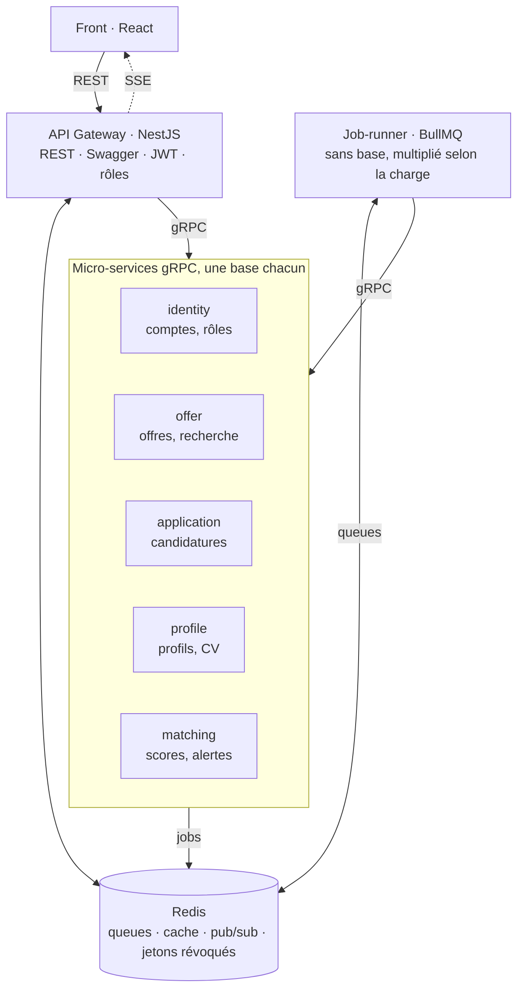

# Poste-it

**La plateforme d'offres d'emploi et de stages qui lit votre CV et explique chaque score.**

Le candidat dépose son CV. Poste-it en extrait les compétences et lui propose les offres classées par correspondance, avec la raison de chaque score : « 4 compétences obligatoires sur 5, télétravail compatible ». Le recruteur publie une offre, reçoit en direct les meilleurs profils et suit chaque candidature jusqu'à l'embauche.

> Projet de groupe du module WebService, Master 2 Expert en développement web, Ynov.
> En développement : la première version de démonstration est prévue au jalon `v0.1`.

## Fonctionnement

**Côté candidat**

1. Il dépose son CV en PDF.
2. Ses compétences apparaissent quelques secondes plus tard. Il les valide ou les corrige.
3. Il reçoit les offres qui lui correspondent, classées et expliquées, puis il postule.
4. Il suit chaque candidature : envoyée, vue, entretien, offre, refusée.

**Côté recruteur**

1. Il publie une offre avec ses compétences obligatoires et souhaitées.
2. L'offre est comparée à tous les profils. Le calcul est réparti sur plusieurs instances.
3. Il reçoit le classement des candidats et fait avancer leurs candidatures.

## Architecture



- **Le front ne parle qu'à la gateway**, seul point d'entrée de l'API, documenté en Swagger.
- **Chaque service possède sa base** MongoDB. Aucun service ne lit la base d'un autre.
- **Le travail lent passe par des queues** : analyse des CV, matching, notifications, maintenance. Chaque instance du job-runner choisit ses queues par variable d'environnement.
- **Le score est déterministe.** Une fonction pure le calcule : il est testable, explicable, et un texte caché dans un CV ne peut pas le modifier.

## Stack

| Couche | Technologies |
| --- | --- |
| Front | React, Vite, TypeScript |
| API et services | NestJS, gRPC, TypeScript strict |
| Jobs | BullMQ |
| Données | MongoDB (une base par service), GridFS pour les CV, Redis |
| Qualité | ESLint (config flat), Prettier, Vitest, Testing Library |
| Livraison | pnpm workspaces, Docker Compose, GitHub Actions |

## Structure

```text
apps/
  front/          interface candidats et recruteurs
  gateway/        API REST, authentification, contrôle d'accès
  identity/       comptes, entreprises, rôles
  offer/          offres et recherche
  application/    candidatures et pipeline de recrutement
  profile/        profils et CV
  matching/       scores, classements, alertes
  job-runner/     exécution des tâches asynchrones
packages/
  contracts/      contrats gRPC partagés
  eslint/         configurations ESLint partagées
  tsconfig/       configurations TypeScript partagées
docs/             documentation technique
```

## Démarrage

Les commandes de lancement arrivent avec le jalon `v0.1`. Un seul `docker compose up` démarrera toute la plateforme, avec des bases pré-remplies.

## Contribuer

Le guide [CONTRIBUTING.md](CONTRIBUTING.md) décrit les branches, les commits, les pull requests et ce qu'on attend d'une story terminée. Pour signaler une faille, lisez [SECURITY.md](SECURITY.md).
